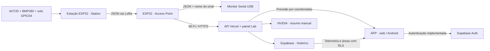

# AgroSense

Protótipo de TCC do curso de Sistemas de Informação do IFMG, Campus Ouro Branco. Reúne medições de uma estação ESP32 e previsão meteorológica por área para apoiar o planejamento da irrigação.

## Começar por aqui

Acesse a [versão web](https://agrosense-app.vercel.app/agro/) ou abra o projeto Android em `APP`.

| O que você quer fazer | Onde começar |
| --- | --- |
| Instalar, entrar e testar o app | [Aplicativo web e Android](APP/README.md) |
| Preparar o Supabase e publicar a API | [Backend](backend/README.md) |
| Configurar os dois ESP32 | [Montagem e firmware](#montar-e-programar-os-esp32) |
| Calibrar a leitura do solo | [Roteiro de calibração](CalibracaoSolo/README.md) |
| Conferir protocolo, RSSI e pareamento | [Protocolo de dados](#protocolo-de-dados) · [RSSI](RSSI-LEIA-ME.md) |

## O que o protótipo faz

1. O Station mede temperatura e umidade do ar com AHT20, pressão local com BMP280 e o sinal analógico do sensor capacitivo de solo.
2. O Access Point recebe o JSON por LoRa, classifica o sinal e envia a leitura por HTTPS à API. O banco grava a hora de recebimento.
3. No aplicativo web ou Android, faça login, abra **Áreas e culturas** e cadastre uma área. Informe coordenadas para consultar a previsão por área. Uma estação autorizada pode ser vinculada à área e receber as referências de calibração.
4. Abra **Telemetria** para ver as últimas coletas da conta. As telas de demonstração continuam identificadas. O painel Lab é separado e serve para diagnosticar ingestão e, se configurado, resumir as coletas com NVIDIA.

Os parâmetros da cultura são definidos por área: cultura, estágio, limites inferior e superior de solo com unidade, volume e janela de chuva, Kc, fonte técnica e condições de aplicação. Em Áreas, selecione uma estação vinculada para comparar seu último índice relativo com a faixa cadastrada. A tela usa o horário de recebimento e sinaliza leituras recebidas há mais de 35 minutos. Uma amostra que ficou na fila pode ter sido coletada antes. A comparação volumétrica exige outro tipo de leitura. A previsão meteorológica é exibida à parte e as regras de recomendação de irrigação ainda exigem validação agronômica.

Para bancada, comece com **um Station**, **um Access Point** e o identificador **station1**. Os ensaios anteriores com LoRa e Wi-Fi descritos abaixo são históricos. A publicação em um novo ambiente exige repetir os testes de ponta a ponta.

## Arquitetura



O aplicativo usa Supabase Auth e políticas por conta para consultar telemetria e gerenciar áreas. O painel Lab consulta a API com credencial própria.

## Organização do repositório

```text
Agrosense/
├── README.md
├── .gitignore
├── .gitattributes
├── APP/
│   ├── README.md                    Documentação específica do aplicativo
│   ├── frontend/
│   │   ├── src/                     Telas, componentes, autenticação e dados demo
│   │   ├── tests/                   Configuração dos testes de interface
│   │   ├── .env.example             Modelo das variáveis públicas do Supabase
│   │   ├── package.json
│   │   └── package-lock.json
│   ├── app/                         Projeto Android/WebView em Kotlin
│   ├── scripts/build-frontend.mjs    Geração da interface para o Android
│   ├── gradle/                      Wrapper e catálogo de dependências
│   ├── gradlew
│   ├── gradlew.bat
│   └── settings.gradle.kts
├── Station/
│   ├── Station.ino               Configuração, coleta e transmissão
│   ├── SensorReadings.h              Coordenação dos sensores
│   ├── Aht20Reader.h                 Leitura AHT20 com timeout e CRC
│   ├── RadioLink.h                   Configuração AT e transporte UART
│   └── COMO-FUNCIONA-STATION.txt
├── AccessPoint/
│   ├── AccessPoint.ino                  Validação e classificação por estação
│   ├── RadioLink.h                   Transporte UART e extração do RSSI
│   └── COMO-FUNCIONA-ACCESS-POINT.txt
├── backend/
│   └── README.md                    API, painel, configuração e testes
└── RSSI-LEIA-ME.md                   Detalhes do protocolo e da escala de sinal
```

O projeto Android completo fica dentro de `APP`, incluindo a subpasta `APP/app`. Abra `APP` no Android Studio. Para Arduino, abra cada `.ino` na pasta de mesmo nome, mantendo seus arquivos `.h` juntos.

## Tecnologias

| Camada | Tecnologias |
| --- | --- |
| Interface | React 19, TypeScript, Vite 8 e CSS |
| Autenticação | Supabase JS e Supabase Auth |
| Android | Kotlin, Android WebView, AndroidX e Gradle Wrapper |
| Testes do aplicativo | Vitest, Testing Library, TypeScript e ESLint |
| Dispositivos | ESP32 com framework Arduino |
| Rádio | DX-LR32-900T22D, comunicação UART e modo transparente |
| Sensores | AHT20, BMP280 e sensor capacitivo de solo no GPIO34 |
| Mensagens | JSON, com ArduinoJson 7 no firmware |
| Backend próprio | Node.js, Vercel e Supabase PostgreSQL |

O DX-LR32 é um modem UART. Os firmwares deste repositório não usam a biblioteca `LoRa.h` para rádios SPI e não implementam LoRaWAN.

## Preparar o ambiente

### Obter o projeto

```sh
git clone https://github.com/Vitorhrm/Agrosense.git
cd Agrosense
```

### Requisitos por componente

| Componente | Requisitos |
| --- | --- |
| Web | Node.js 22.12 ou superior, npm e projeto Supabase para autenticação |
| Android | Requisitos web, Android Studio, SDK Android 37 e JDK compatível com o Gradle versionado |
| Station/Access Point | Arduino IDE ou Arduino CLI, suporte `esp32` da Espressif e as bibliotecas indicadas abaixo |
| Hardware | Dois ESP32, dois módulos DX-LR32-900T22D com antenas e alimentação adequada; sensores na estação |

As versões exatas das dependências web estão em `APP/frontend/package-lock.json`; as do Android ficam nos arquivos Gradle dentro de `APP`. Use o Gradle Wrapper do projeto e prefira o JDK fornecido pelo Android Studio.

## Executar o aplicativo web

### 1. Instalar as dependências

Na raiz do repositório:

```sh
cd APP/frontend
npm ci
```

### 2. Configurar o Supabase

Dentro de `APP/frontend`, crie o arquivo local de configuração. No PowerShell:

```powershell
Copy-Item .env.example .env.local
```

No Linux/macOS:

```sh
cp .env.example .env.local
```

Preencha `APP/frontend/.env.local`:

```dotenv
VITE_SUPABASE_URL=https://seu-projeto.supabase.co
VITE_SUPABASE_PUBLISHABLE_KEY=sb_publishable_sua_chave_publica
```

Use a URL e a chave pública **publishable** do seu projeto. As variáveis `VITE_` são incorporadas ao frontend e são públicas; não coloque chaves administrativas, `service_role`, `sb_secret_` ou senhas de banco nesse arquivo. Habilite autenticação por e-mail no Supabase. A confirmação de e-mail segue a configuração desse serviço.

### 3. Iniciar

Ainda em `APP/frontend`:

```sh
npm run dev
```

Abra [http://127.0.0.1:5173](http://127.0.0.1:5173). A porta é fixa; se estiver ocupada, encerre o processo que a utiliza antes de iniciar novamente.

Para gerar e visualizar o build web:

```sh
npm run build
npm run preview
```

O build web fica em `APP/frontend/dist`. Reinicie o servidor de desenvolvimento ou recompile após alterar a configuração local.

## Executar o aplicativo Android

1. Instale as dependências e configure o Supabase em `APP/frontend`.
2. Abra a pasta **`APP`** no Android Studio.
3. Sincronize o Gradle e disponibilize o SDK solicitado pelo projeto.
4. Escolha um dispositivo ou emulador e execute **Run**.

O aplicativo exige Android 7.0/API 24 ou superior. A interface é a mesma do frontend, carregada em uma WebView. O Kotlin cuida da integração nativa, da janela e do botão Voltar.

Pelo PowerShell, execute a partir de `APP`:

```powershell
.\gradlew.bat :app:assembleDebug :app:lintDebug
```

No Linux/macOS, também a partir de `APP`:

```sh
./gradlew :app:assembleDebug :app:lintDebug
```

O APK de depuração fica em `APP/app/build/outputs/apk/debug/app-debug.apk`. O Gradle executa `scripts/build-frontend.mjs`, verifica os tipos e gera a interface antes de empacotar os assets. Não edite manualmente os arquivos gerados em `APP/app/src/main/assets/agrosense`.

Se o Android Studio não localizar o Node.js, adicione sua localização a `APP/local.properties`, preservando `sdk.dir`:

```properties
NODE_BINARY=C:/caminho/para/node.exe
```

`local.properties` depende da máquina e não deve ser versionado. O identificador Android atual é `com.example.agrosense`.

## Montar e programar os ESP32

### Componentes

- Dois ESP32 clássicos compatíveis com a configuração `ESP32 Dev Module`.
- Dois módulos LoRa **DX-LR32-900T22D**, com antenas compatíveis.
- Um módulo combinado AHT20 + BMP280, conectado à Station.
- Um sensor capacitivo de umidade do solo conectado ao GPIO34 e habilitado.
- Cabos e alimentação adequados aos módulos.

### Ligações de dados

| ESP32 | Componente | Aplicação |
| --- | --- | --- |
| GPIO16 / RX2 | TX do LoRa | Station e Access Point |
| GPIO17 / TX2 | RX do LoRa | Station e Access Point |
| GPIO21 | SDA do AHT20 + BMP280 | Somente Station |
| GPIO22 | SCL do AHT20 + BMP280 | Somente Station |
| GPIO25 | EN do load switch | Somente Station |
| GPIO34 / ADC1 | AO do sensor de solo | Somente Station, quando conectado |
| GND | GND dos módulos | Terra comum |

TX e RX devem estar cruzados. Os sinais do ESP32 e a UART do LoRa são de 3,3 V. O manual do DX-LR32 informa alimentação de 3,3 a 5,5 V; dimensione a fonte para os picos de transmissão e conecte a antena antes de transmitir. Alimente os sensores de forma compatível com sua placa e mantenha AO do solo dentro de 3,3 V.

M0, M1 e AUX não são ligados ao ESP32 nesta versão. Com o modo de fábrica `SWITCH=0`, o controle é por comandos AT; se o módulo tiver sido alterado para `SWITCH=1`, M0/M1 passam a determinar seu modo e não podem ficar flutuando. Não aterre esses pinos sem verificar o modo atual, pois em `SWITCH=0` eles são saídas. O firmware não muda automaticamente `SWITCH`.

Os GPIOs indicados pressupõem um ESP32 clássico sem PSRAM ocupando GPIO16/17. Confira a variante da sua placa antes da montagem.

### Bibliotecas e suporte da placa

No Arduino IDE, instale o suporte **esp32**, da Espressif Systems, e as bibliotecas:

- **ArduinoJson 7**;
- **Adafruit BMP280 Library**, com suas dependências.

`Wire` e `HardwareSerial` fazem parte do suporte ESP32. A leitura do AHT20 é implementada em `Aht20Reader.h`, com prazo de espera e verificação CRC-8; não requer a biblioteca Adafruit AHTX0.

Referência das compilações anteriores do firmware: suporte ESP32 3.3.12, ArduinoJson 7.4.3 e Adafruit BMP280 Library 3.0.0. Estas versões são uma referência de ambiente, não uma trava automática de instalação.

### Configurar a estação

No início de `Station/Station.ino`:

```cpp
constexpr uint64_t SLEEP_INTERVAL_US = 15ULL * 60 * 1000000;
constexpr char NODE_ID[] = "station1";
constexpr bool SOIL_SENSOR_ENABLED = true;
```

| Variável | Significado |
| --- | --- |
| `SLEEP_INTERVAL_US` | Tempo em deep sleep entre ciclos, 15 minutos |
| `NODE_ID` | Identificador único por estação, de 1 a 24 bytes |
| `SOIL_SENSOR_ENABLED` | Ativa a leitura de solo; mantenha `false` até conectar o sensor |
| `SOIL_ANALOG_PIN` | Pino analógico do solo, GPIO34 por padrão |
| `LORA_BAUD_RATE` | Velocidade da UART do modem, 9600 baud por padrão |

Para mais estações, use `station1`, `station2`, `station3` etc. As transmissões não têm escalonamento nem retransmissão; pacotes simultâneos podem colidir. Intervalos muito curtos também podem exceder a capacidade do enlace.

### Gravar e observar

1. Abra `Station/Station.ino` mantendo todos os `.h` na mesma pasta.
2. Selecione a placa e a porta do ESP32 conectado aos sensores e grave o sketch.
3. Abra `AccessPoint/AccessPoint.ino`, selecione o outro ESP32 e grave-o.
4. Abra o Monitor Serial do Access Point a **115200 baud**.
5. Confira a configuração do modem e as linhas JSON identificadas por `node`.

As portas COM dependem do computador e podem mudar ao reconectar. **115200** é a velocidade do Monitor Serial USB; **9600** é a velocidade padrão da UART entre ESP32 e modem.

### Configuração dos rádios

Na inicialização, o firmware verifica comandos AT e consulta os parâmetros antes de alterá-los. Confirma modo transparente, tamanho de pacote de 230 bytes, operação contínua `SLEEP=2` e o estado do byte RSSI — ativado em ambos os equipamentos. A saída do modo AT reinicia o modem para aplicar os ajustes.

Canal, nível de velocidade pelo ar e chave não são definidos pelo código. Os dois rádios precisam de configurações RF compatíveis. O firmware usa o protocolo documentado para DX-LR32; não substitua os comandos ou a fórmula RSSI por exemplos de E220/E22 sem verificar a compatibilidade.

## Protocolo de dados

### JSON enviado pela estação

Exemplo ilustrativo, sem representar uma leitura real:

```json
{
  "v": 1,
  "node": "station1",
  "seq": 1,
  "uptime_ms": 1500,
  "temp_c": 25.4,
  "air_rh_pct": 61.2,
  "pressure_hpa": 931.5,
  "soil_raw": 0,
  "soil_enabled": false
}
```

| Campo | Tipo | Unidade / finalidade |
| --- | --- | --- |
| `v` | Número | Versão do protocolo, atualmente 1 |
| `node` | Texto | Identificador da estação |
| `seq` | Inteiro sem sinal | Número da coleta; reinicia no boot |
| `uptime_ms` | Inteiro sem sinal | Tempo desde o boot em ms; não é data/hora de calendário |
| `temp_c` | Número ou `null` | Temperatura do AHT20, em °C |
| `air_rh_pct` | Número ou `null` | Umidade relativa do ar, em % |
| `pressure_hpa` | Número ou `null` | Pressão local do BMP280, em hPa, sem correção ao nível do mar |
| `soil_raw` | Inteiro | Média de 16 amostras do ADC, de 0 a 4095; zero se desativado |
| `soil_index_pct` | Número opcional | Índice relativo de 0–100 quando há calibração na Station |
| `soil_enabled` | Booleano | Indica se a leitura de solo está ativada no código |

Falhas ou leituras ambientais inválidas são representadas por `null`. O solo desativado usa zero conforme a regra do protótipo; esse zero não significa solo seco. A entrada analógica desconectada pode produzir valores arbitrários, por isso a ativação é manual. Um percentual de umidade do solo exige calibração seco/molhado com o sensor e o solo utilizados.

`uptime_ms` e `seq` reiniciam com o dispositivo. Para HTTPS, o Access Point acrescenta um UUID `event_id` mantido nas retentativas; o banco usa esse UUID para evitar duplicatas.

### Transporte e saída do Access Point

O JSON é irradiado em uma única linha terminada em LF. O firmware limita o JSON a **229 bytes**, mais **1 byte LF**, dentro de um pacote RF de 230 bytes. No lado Access Point, o modem acrescenta um byte **binário** de RSSI após o pacote. Esse byte é metadado do modem, não um campo transmitido no JSON pela estação.

O Access Point separa os dados do RSSI, valida o formato e acrescenta `signal` à saída USB:

```json
{"v":1,"node":"station1","seq":1,"uptime_ms":1500,"temp_c":25.4,"air_rh_pct":61.2,"pressure_hpa":931.5,"soil_raw":0,"soil_enabled":false,"signal":"Bom"}
```

Os valores numéricos de RSSI/SNR não são incluídos nessa saída. O parser suporta fragmentação da entrega pela UART, mas pressupõe **um pacote RF por coleta**, sem prefixos adicionais. Mensagens inválidas, excessivas ou interrompidas são descartadas. O ACK confirma a entrada na fila do Access Point. Terminar o envio pela UART só confirma a entrega ao modem local.

## Calibração do solo

O utilitário [`CalibracaoSolo`](CalibracaoSolo/README.md) captura referências seca e saturada no GPIO34. Preencha `Station/SoilCalibrationConfig.h` com as médias medidas e regrave a estação. As referências começam desabilitadas; não há valores universais prontos. Quando calibrado, a Station envia `soil_index_pct` como índice relativo de 0–100 e continua enviando `soil_raw`. Leituras antigas podem ser convertidas no app com as referências da estação. Para teor de água e decisões de irrigação, é necessária calibração específica com amostras de referência. Consulte o guia para procedimento, limitações e fontes.

## Classificação do sinal por estação

O cálculo acontece exclusivamente no **Access Point**, a partir do pacote da estação identificada em `node`. O campo `signal` descreve o sentido **estação → Access Point** naquela coleta.

| RSSI interno | Valor de `signal` |
| --- | --- |
| ≥ −60 dBm | `Muito próximo` |
| ≥ −90 e < −60 dBm | `Bom` |
| ≥ −115 e < −90 dBm | `Regular` |
| ≥ −130 e < −115 dBm | `Zona de limite` |
| < −130 dBm | `Crítico` |

Internamente, o firmware aplica a fórmula do manual DX-LR32: `RSSI_dBm = byte_recebido - 255`. Por exemplo, `0xAB` corresponde a 171; `171 - 255 = -84 dBm`, classificado como `Bom`.

Essas categorias são a escala escolhida para o projeto. Elas não medem distância, não garantem ausência de perdas e não alteram automaticamente a velocidade do rádio. A classificação usa o pacote atual, sem média, SNR ou taxa de entrega. O guia UART consultado não documenta SNR por pacote para leitura pelo ESP32.

Cada JSON associa o sinal ao seu `node`; o RSSI de uma estação não é reutilizado para outra. Se uma estação parar de enviar, não existe medição nova: o firmware atual não mantém uma tabela de dispositivos online/offline nem gera automaticamente um estado “Sem sinal”.

## Descoberta e pareamento LoRa

Configure primeiro o Access Point pelo Bluetooth do app Android. Escolha o SSID e a senha da rede LoRa e salve. Em seguida, conecte à Station pelo Bluetooth, busque as redes LoRa, escolha o SSID anunciado pelo Access Point e digite a senha. O Station só confirma o vínculo depois de validar a resposta do Access Point. Com a rede configurada, o Access Point aceita coletas autenticadas pela senha compartilhada. Um identificador estável permite ao backend descartar retransmissões da mesma coleta.

O nome da rede é do AgroSense. A busca ocorre no canal LoRa configurado nos modems DX-LR32, que precisam usar os mesmos parâmetros RF. O PIN Bluetooth, a senha do Wi-Fi, a senha LoRa e o código de ativação da estação têm funções distintas.

Para autorizar a telemetria pela primeira vez, informe no cadastro da Station o código de ativação de uso único da estação. Depois disso, selecione a área na mesma tela. Consulte o [passo a passo Android](APP/README.md).

## Backend e Supabase

O [backend](backend/README.md) recebe as coletas por HTTPS e grava no Supabase. A [versão web](https://agrosense-app.vercel.app/agro/) usa as mesmas contas, áreas e telemetria do app Android. O [painel Lab](https://agrosense-app.vercel.app/lab) tem login separado para diagnóstico.

Configure a URL e o token do Access Point em `AccessPoint/CloudConfig.local.h`. O Wi-Fi pode ser configurado pelo app Android ou ter valores iniciais em `AccessPoint/WifiConfig.local.h`. Esses arquivos são privados e ignorados pelo Git.
## Testes e validação

### Aplicativo

Execute em `APP/frontend`:

```sh
npm run typecheck
npm run lint
npm test
npm run build
```

Os testes cobrem autenticação, sessão, rotas, telemetria, calibração e BLE com respostas simuladas. As respostas do Supabase são simuladas; esses testes não criam usuários nem enviam e-mails reais.

Para Android, execute em `APP`:

```powershell
.\gradlew.bat :app:assembleDebug :app:lintDebug
```

Teste também login/cadastro no seu projeto Supabase, confirmação de e-mail quando habilitada, reabertura com sessão, logout, navegação Android e comportamento sem rede.

### Firmware

Na raiz, com suporte de placa e bibliotecas já instalados:

```sh
arduino-cli compile --fqbn esp32:esp32:esp32 Station
arduino-cli compile --fqbn esp32:esp32:esp32 Access Point
```

As compilações anteriores foram verificadas para `ESP32 Dev Module`. Também foram feitos testes de lógica com entradas simuladas durante o desenvolvimento: limites da escala RSSI, respostas AT, fragmentação UART, bytes RSSI especiais, identificação de estações, descarte/recuperação de pacotes, CRC e timeout do AHT20. Esse verificador auxiliar não integra uma suíte executável versionada neste repositório.

**Validação física realizada em 05/11/2026:** a Station coletou AHT20, BMP280 e solo no GPIO34. O Access Point na COM5 recebeu o JSON por LoRa, classificou o RSSI por `node`, conectou ao Wi-Fi e enviou as coletas por HTTPS. O recebimento no Supabase, a consulta no painel de teste e a geração de resumo NVIDIA foram confirmados. Cinco testes automatizados do backend passaram. Esse ensaio é anterior à integração do aplicativo e não cobre o novo ambiente ou o uso em campo.

Para configurar a rede do Access Point, copie `AccessPoint/WifiConfig.example.h` para `WifiConfig.local.h` e preencha SSID e senha de uma rede de 2,4 GHz. Configure URL e token em `CloudConfig.local.h`, usando `CloudConfig.example.h` como modelo. Os arquivos locais não são versionados. O envio roda em tarefa separada; a recepção LoRa e o Serial continuam ativos sem internet. Consulte o [guia da API](backend/README.md) para certificados HTTPS, fila em RAM, retentativas e variáveis da Vercel.

## Solução de problemas

| Sintoma | O que verificar |
| --- | --- |
| Primeiro `AT` sem resposta | Pode ocorrer em modo transparente; observe o resultado após `+++` e o segundo teste AT |
| `[nenhum byte recebido do LoRa]` após o escape | TX/RX cruzados, GND comum, alimentação, baud local e modo M0/M1 |
| Respostas ilegíveis ou muitos bytes hexadecimais | Baud, integridade das ligações e alimentação; não interpretar esses bytes como RSSI válido |
| Configuração AT falhou | O firmware bloqueia o processamento normal; no Access Point, a ponte de diagnóstico permite enviar comandos pela USB |
| Comandos manuais no Access Point | Monitor Serial a 115200; selecione **Both NL & CR** e envie `+++` e depois `AT` separadamente; reinicie após diagnosticar |
| Access Point pronto, mas sem coletas | Confira envio da station, parâmetros RF compatíveis, antenas e versão dos firmwares |
| JSON/RSSI incompleto ou inválido | Confira `DRSSI` no Access Point, pacote de 230 bytes, ausência de prefixos e uma coleta por pacote RF |
| Sensores com `null` | Verifique alimentação, SDA/SCL, endereços e conexão física dos sensores |
| Solo sempre zero | Confira `SOIL_SENSOR_ENABLED`; a flag falsa envia zero intencionalmente |
| Login indisponível | Confira `.env.local`, as variáveis públicas e o provedor de e-mail no Supabase |
| Cadastro pede confirmação | Confira a caixa de e-mail e a configuração de confirmação do projeto Supabase |
| Porta web ocupada | Libere `127.0.0.1:5173`; o servidor usa porta fixa |
| Android sem encontrar Node.js | Configure `NODE_BINARY` em `APP/local.properties` |

O modem real responde às consultas AT com o valor consultado, sem `OK` adicional. Essa diferença foi corrigida e validada em bancada. O comando `AT` e os comandos de escrita continuam exigindo `OK`; as consultas exigem a linha exata do valor esperado.

## Cuidados de configuração

- Mantenha arquivos locais e segredos fora do Git: `.env.local`, `local.properties`, senhas, chaves administrativas e arquivos de assinatura.
- Versione somente o modelo `.env.example` com valores fictícios.
- A chave publishable do Supabase é pública; os dados futuros precisam de autorização no servidor/banco, não apenas de proteção visual das telas.
- Use nomes únicos e curtos para as estações. `NODE_ID` é identificação, não autenticação de um dispositivo.
- A chave de rádio deve ser compatível entre os módulos; o código atual não configura nem revela essa chave.
- O provisionamento BLE está no app Android e precisa de teste físico. A descoberta e o pareamento LoRa são etapas separadas.

## Próximas etapas

- [x] Validar a configuração AT e a comunicação real dos módulos LoRa na bancada.
- [x] Conectar e coletar o sensor de solo no GPIO34.
- [ ] Calibrar o sensor de solo antes de exibir percentual ou recomendar irrigação.
- [ ] Testar estabilidade, perdas e colisões com múltiplas estações.
- [x] Implementar API de ingestão, armazenamento Supabase e painel experimental.
- [ ] Integrar a API às telas do aplicativo original e ao cadastro de áreas/usuários.
- [x] Implementar e validar o encaminhamento Wi-Fi/HTTPS das coletas pelo Access Point.
- [ ] Vincular dispositivos e áreas a usuários com autorização adequada.
- [ ] Substituir os dados demonstrativos do aplicativo por dados reais.
- [x] Preparar o provisionamento BLE Android e o cadastro de dispositivos por conta.
- [ ] Validar em bancada o BLE, a descoberta por SSID e o pareamento LoRa.
- [ ] Integrar dados meteorológicos reais e validar as regras de apoio à irrigação.
- [ ] Adicionar integração contínua e testes de ponta a ponta conforme as integrações evoluírem.

## Contribuição e manutenção

Um único repositório mantém os contratos e as versões das quatro partes próximos. Crie branches para alterações, descreva o comportamento esperado e execute os testes relevantes antes de integrar mudanças.

- Ao alterar o JSON, atualize Station, Access Point, documentação e futuros consumidores juntos.
- Ao alterar `RadioLink.h`, mantenha suas cópias em `Station` e `Access Point` consistentes; cada sketch Arduino precisa ser autocontido.
- No aplicativo, mantenha a autenticação em `APP/frontend/src/features/auth` e reutilize o cliente de `APP/frontend/src/lib/supabase.ts`.
- Preserve `package-lock.json` e use `npm ci` para instalações reproduzíveis.
- Abra issues para registrar problema, comportamento esperado e passos de reprodução. Não inclua credenciais nos logs.
- Separe em repositórios independentes apenas se as partes passarem a ter equipes, permissões ou ciclos de publicação realmente distintos.

## Autor, licença e referências

**Autor:** [Vitor Matias — Vitorhrm](https://github.com/Vitorhrm). Projeto acadêmico em desenvolvimento no contexto do TCC de Sistemas de Informação do IFMG.

**Licença:** este repositório ainda não possui um arquivo `LICENSE`. Uma licença de distribuição deverá ser definida pelo autor; as dependências mantêm suas próprias licenças.

Documentação complementar:

- [Aplicativo](APP/README.md)
- [Funcionamento da station](Station/COMO-FUNCIONA-STATION.txt)
- [Funcionamento do Access Point](AccessPoint/COMO-FUNCIONA-ACCESS-POINT.txt)
- [Notas sobre RSSI e transporte](RSSI-LEIA-ME.md)
- [Escopo do backend](backend/README.md)
- [DX-LR32-900T22D — manual técnico](https://www.szdx-smart.com/static/upload/2025/12/11/202512111463.pdf)
- [DX-LR32-900T22D — guia UART e fórmula RSSI](https://www.szdx-smart.com/static/upload/2025/12/11/202512112006.pdf)
- [AHT20 — datasheet do fabricante disponibilizado pela Adafruit](https://cdn-learn.adafruit.com/assets/assets/000/091/676/original/AHT20-datasheet-2020-4-16.pdf)
- [Adafruit BMP280 Library](https://github.com/adafruit/Adafruit_BMP280_Library)
- [ArduinoJson 7](https://arduinojson.org/v7/)
- [Supabase](https://supabase.com/docs)

## Alimentação e deep sleep da Station

Ligue G a GND, EN ao GPIO25, VI a 3V3 e VO ao VCC dos sensores e do rádio LoRa. O código assume EN ativo em HIGH. Ajuste `LOAD_SWITCH_ON` no firmware e no sketch de calibração se o módulo usar a polaridade oposta. Os pull-ups do I²C precisam estar no lado alimentado por VO para evitar alimentação pelo barramento.

No primeiro cadastro, o Bluetooth fica disponível até salvar a configuração. Ao reiniciar manualmente uma Station já configurada, a janela Bluetooth é de cinco minutos. Ao salvar e desconectar, o ESP32 encerra o Bluetooth, coleta e aguarda o ACK do Access Point. Nos despertares pelo timer, ele liga os periféricos, espera a estabilização, coleta, transmite e volta a dormir por 15 minutos. O Wi-Fi da Station não é inicializado.

O ACK confirma que o Access Point aceitou a coleta na fila local. O envio HTTPS ocorre depois. A Station grava cada coleta em uma fila de flash com 24 posições. Ela envia da mais antiga para a mais nova, até quatro por despertar, e remove cada leitura depois do ACK. Se faltar confirmação, tenta até cinco vezes, com pausa de dois segundos, e volta a dormir por 15 minutos. Quando a fila enche, preserva as 24 coletas mais recentes. O horário exibido na nuvem é o de recebimento, então uma coleta atrasada não carrega o horário original de aquisição. Se o rádio estiver pareado, o ACK é autenticado.

Para um LED controlável por GPIO, configure `STATION_LED_PIN` e `STATION_LED_OFF`. LEDs ligados direto à alimentação exigem corte físico para apagar. O consumo real e a estabilidade da saída VO durante a transmissão precisam ser medidos na bancada.
